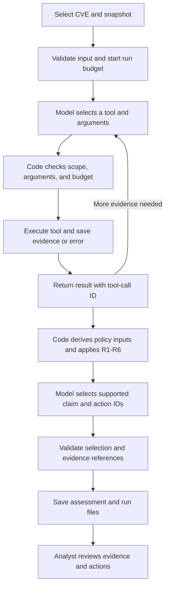

# Security Triage Agent design

**Case:** CVE-2024-21762, Northbridge Services N02 FortiOS VPN gateways

**Team:** Atharva Jog, Varun Bhanushali, Shweta Mittal, Deekshitha

## 1. Task, inputs, and output

The agent checks whether the vulnerability applies to N02, what access an attacker would need, and what the business consequences could be. It returns a risk rating, a separate response priority, supporting evidence, uncertainty, and recommended actions.

Inputs:

- CVE ID and policy version.
- An environment snapshot from `data/environment/`.
- Affected-version information from the Fortinet CNA record.
- SSL-VPN prerequisite information from CERT-EU.
- Exploitation context from CISA KEV.

The baseline snapshot comes from `Windows_Enterprise_Environment.docx`:

| Fact | What is known |
| --- | --- |
| N02 | Two FortiGate 100F gateways running FortiOS |
| Firmware | Exact versions are unknown |
| VPN endpoint | Public TCP/443 service; SSL-VPN configuration and termination are unknown |
| Business role | Production remote access in an organization with 1,000 employees, including 150 remote staff |
| Access policy | Unlisted inter-zone traffic is denied; downstream access is not established |
| Telemetry | VPN, firewall, and identity logs are retained for 90 days; event records are not supplied |

The companion JSON, CSV, and lookup script named in the DOCX were not supplied. The snapshot therefore retains the document's unknowns. All local evidence is labeled `simulated`. Variants add explicit test overrides for one gateway instance.

Outputs are `assessment.json`, `assessment.md`, the exact input snapshot, saved evidence, model messages, tool trace, configuration, and run manifest.

The assessment records:

- Asset, CVE, snapshot, scope, timestamp, and policy version.
- Status, rule, rating, priority, and rationale.
- Applicability, attack path, Internet reachability, and business impact, with evidence IDs.
- Source URLs or document locators, retrieval dates, source modes, and hashes.
- Unknowns, conflicts, assumptions, limitations, and qualitative confidence.
- Recommended actions, owners, urgency, and evidence needed for reassessment.
- Execution failures and a separate review status.

## 2. Workflow and risk policy

One agent uses three read-only tools. Duke AI Gateway provides the tool-calling model; `config/agent.json` sets the model and run limits. The replay provider supplies scripted responses for offline tests.

The model chooses evidence queries. Code compares versions, applies the policy, and validates the final selection. Reports use registered claims and actions, so the model cannot change the decision or add unsupported citations.

Applicability requires a matching product, affected firmware, and enabled SSL-VPN. Attack-path support is checked separately. Internet reachability refers to the affected component. Unknown values remain unknown; conflicting records remain available for review.

Versions are compared numerically within a documented release branch. An unknown build or unlisted branch returns unknown. FortiOS 7.2.6 and 7.2.7 are affected/fixed boundary test values for this CVE, rather than deployment recommendations.

| Impact | Criteria |
| --- | --- |
| High | Major consequences for production access, sensitive data, identity, recovery, or another supported critical dependency |
| Medium | Consequences limited to a noncritical team or service with evidenced separation from sensitive production systems |
| Low | Minor consequences in an isolated, low-value test service without sensitive credentials or production dependencies |
| Unknown | Evidence cannot establish business use or consequence level |

N02's production remote-access role supports the High impact interpretation, subject to review. The evidence does not establish domain takeover, direct database access, a specific outage duration, or local compromise.

| Rule | Evidence-supported conditions | Decision | Priority |
| --- | --- | --- | --- |
| R1 | Vulnerability applies, the vulnerable service is Internet reachable, and compromise could cause major business consequences | High | Critical |
| R2 | Vulnerability applies through a supported attack path and could cause major consequences, but R1 is not met | High | High |
| R3 | Vulnerability applies through a supported attack path and consequences are limited to a service or small user group | Medium | Medium |
| R4 | Vulnerability applies, but supported consequences are minor and confined to a low-value, isolated service | Low | Low |
| R5 | Evidence confirms a decisive prerequisite is absent, such as an unaffected version or disabled vulnerable component | Low | Informational |
| R6 | Missing or conflicting evidence prevents determining applicability, attack path, or impact | Insufficient evidence / Review | Insufficient evidence / Review |

Policy order:

1. Reject invalid fields, evidence, or contradictory attack-path inputs with Review.
2. Apply R5 when a required prerequisite is confirmed absent, even if unrelated facts are unknown.
3. Apply R6 for unresolved decisive gaps or conflicts. Missing facts produce Insufficient evidence; conflicts produce Review. Both have a null rating.
4. Apply R1-R4 to supported applicable cases according to exposure and impact.

R2 requires evidence that R1 is not met. Unknown Internet reachability cannot default to an internal-only path when distinguishing Critical from High priority. R4 still requires a supported attack path; isolation limits the consequences.

CVSS describes technical severity. KEV describes reported exploitation. Neither replaces the local applicability and impact checks or proves local compromise.

Actions follow the result: request missing configuration evidence for R6; retain the absent-prerequisite evidence for R5; plan a vendor-supported upgrade for applicable cases; review logs for High-rated cases. An affected but disabled component still receives a patch-planning action.

## 3. Tools and evidence

| Tool | Arguments | Result |
| --- | --- | --- |
| `lookup_environment` | `asset_id`, `snapshot_id` | Local facts, assumptions, unknowns, and DOCX evidence references |
| `lookup_vulnerability` | `cve_id`, `source` (`cna` or `cert`) | FortiOS affected ranges or SSL-VPN prerequisites, with source references |
| `lookup_kev` | `cve_id` | CISA catalog match and exploitation context, or a distinct lookup failure |

Tool results include the call ID, status, evidence IDs, source locators, retrieval time, source mode, hashes, and errors. External evidence is labeled `live` or `cached`; environment evidence is `simulated`.

Live KEV lookups save the full catalog while returning only the matching entry to the model. Cached evidence is checked against its recorded source and hash. Missing source dates remain null.

Credentials are loaded from environment variables or the ignored `.env`. Requests use fixed endpoints, reject redirects, and redact secrets before saving output. External text cannot add tools, change the policy, or execute commands.

## 4. Failures and limits

| Limit | Value |
| --- | --- |
| Tool executions | 8 |
| Model turns | 8 |
| Run duration | 180 seconds |
| Public-source HTTP timeout | 10 seconds |
| Model request timeout | 30 seconds |

A source request has at most two attempts. In `auto` mode, a verified cache can be used after live failure. `live` mode disables fallback. A failed lookup is recorded as an error rather than an unaffected result.

Example: both threat lookups fail and no fallback is allowed. The agent retains the environment evidence, leaves the threat prerequisites unknown, applies R6, and requests the missing evidence. A KEV failure alone does not prevent a supported rating from other evidence.

Invalid tool arguments receive one correction opportunity. Wrong scope, repeated invalid calls, exhausted budgets, model failure, or invalid final synthesis stop execution with Review. A valid R6 result is a completed assessment; an execution failure is recorded separately.

## 5. Testing and review

A complete demonstration includes a model-selected tool call, its executed result returned with the same call ID, environment and external evidence, a checked assessment, and saved run files. An analyst then reviews source passages, scope, impact reasoning, uncertainty, and recommended actions.

Expected results are defined in `scripts/evaluate.py` before execution:

| Scenario | Expected rule | Rating / priority |
| --- | --- | --- |
| Baseline | R6 | Insufficient evidence |
| Positive | R1 | High / Critical |
| Patched firmware | R5 | Low / Informational |
| Internal path, no Internet reachability | R2 | High / High |
| Medium impact | R3 | Medium / Medium |
| Low impact | R4 | Low / Low |
| Missing firmware | R6 | Insufficient evidence |
| Conflicting firmware | R6 | Review |
| Unknown Internet reachability with High impact | R6 | Insufficient evidence |
| Disabled SSL-VPN | R5 | Low / Informational |
| Threat sources unavailable | R6 | Insufficient evidence |

Tests also cover version boundaries, evidence attribution, rejected requests, run limits, cache integrity, final synthesis, and credential handling. Results record expected and actual values, pass/fail, evidence checks, and run paths. Replay tests check the workflow; the Duke demonstration checks the live model integration.

## References

- `Assignment 3_ Build a Security Triage Agent.pdf`: deliverables and rubric.
- `Windows_Enterprise_Environment.docx`: local environment, asset inventory, access policy, telemetry, and business context.
- Class slides in `resources/course/`: agent workflow, tool calls, uncertainty, and runtime controls.
- [Fortinet CNA record](https://github.com/CVEProject/cvelistV5/blob/main/cves/2024/21xxx/CVE-2024-21762.json): affected products, versions, and solutions.
- [CERT-EU advisory 2024-018](https://cert.europa.eu/publications/security-advisories/2024-018/): component and attack prerequisites.
- [CISA KEV catalog](https://github.com/cisagov/kev-data/blob/main/known_exploited_vulnerabilities.json): reported exploitation.
- [NVD case reference](https://nvd.nist.gov/vuln/detail/CVE-2024-21762).
