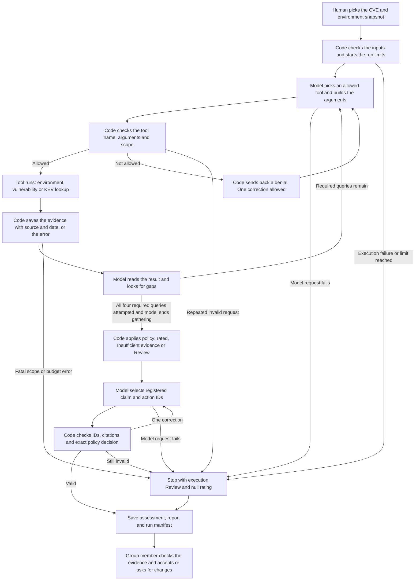

# Step 1 Design: Security Triage Agent

**Case:** CVE-2024-21762 on the N02 FortiOS VPN gateways
**Environment:** Supplied Windows Enterprise Environment (Northbridge Services)
**Members:** Atharva Ashish Jog, Varun Bhanushali, Shweta Mittal, Deekshitha Manjunatha Reddy

## 1. Overview

We built one agent that looks at CVE-2024-21762 and decides how risky it is for the N02 VPN gateways at Northbridge. It collects evidence about the environment and the vulnerability. Then it checks whether the conditions for the attack are actually met in our environment before giving a rating. The output is a risk rating with a separate priority. If a deciding fact is unknown, the agent says Insufficient evidence instead of guessing.

In the environment as given, we don't know the firmware version of the gateways or whether SSL VPN is turned on. So the honest answer for the baseline is Insufficient evidence. To show a full rating, we made separate test versions of the environment and labeled every change as simulated.

### Starting point: Week 3 Design Studio

This design builds on our Week 3 Design Studio worksheet (Team 2 Alert Prioritization, pages 12 to 15 of the studio PDF). We kept the chaining workflow with direct tools and bounded retries. We also kept the validation step and the analyst review at the end. What we changed is the task. Instead of prioritizing SIEM alerts, the agent now checks whether a CVE applies to an asset and how much it would hurt the business.

## 2. Risk question and scope

**Risk question:** Can CVE-2024-21762 be used against the N02 VPN gateway pair, and how much would it hurt Northbridge if it was? The agent also recommends the next step for the analyst.

**About the CVE:** CVE-2024-21762 is an out of bounds write in the FortiOS SSL VPN. An attacker who is not logged in can send crafted HTTP requests and run code on the device. Fortinet's CNA record gives the affected and fixed versions [E1]. CERT-EU explains the SSL VPN attack [E2]. CISA lists it as known exploited [E3]. None of this means Northbridge has been hacked. It only means the CVE is relevant to N02.

### Inputs

| Input | Source |
| --- | --- |
| CVE ID | CVE-2024-21762 |
| CNA record | Fortinet record in the official CVE list [E1] |
| CERT-EU advisory | Security Advisory 2024-018 [E2] |
| KEV entry | CISA KEV catalog [E3] |
| Environment snapshot | `data/environment/baseline.json` (`northbridge-docx-v1`), built from the DOCX |
| Policy version | 2.0 |

The model only gets the N02 asset and the context it needs. It cannot read other project files.

### Target environment

| Item | What the DOCX says | What we take from it |
| --- | --- | --- |
| N02 | Two Fortinet FortiGate 100F gateways running FortiOS, active/standby at HQ | This is the asset we assess. The two gateways could have different firmware or settings, so we don't assume they match. |
| Firmware | Not given | We keep it as unknown. We never guess a version. |
| VPN service | Public VPN endpoint 192.0.2.20:443 with a DMZ and a VPN address pool | The VPN is public. The DOCX does not say it is SSL VPN or which process answers on that port. |
| Access policy S02 | Traffic between zones is denied unless listed. No public RDP, SMB, LDAP, SQL or management interfaces. | A public VPN does not mean direct access to the database or the domain controllers. |
| Business context | 1,000 employees including 150 remote staff. The business runs customer service, orders, invoicing and payroll. | If the VPN goes down or gets taken over, remote work is affected. We state this as an assumption. |
| Logs S04 | VPN, firewall, identity and Microsoft 365 logs kept online for 90 days | We can recommend checking these logs. No log events were given that show a compromise. |
| Impact S05 | Service impact and recovery targets | No recovery time is given for the VPN, so we don't make one up. |

N01 is Palo Alto, so it is not affected by this FortiOS bug. The Windows servers sit behind the VPN, but they are not direct matches for this CVE. MFA does not stop this bug because the attack happens before login.

Every environment fact is labeled `simulated`. The DOCX mentions four companion files (`windows_enterprise_environment.json`, `asset_inventory.csv`, `evidence_register.json` and `lookup_environment.py`) that were never given to us. So we built a small JSON snapshot from the DOCX ourselves. We did not invent the sixteen flow records or the gateway names those files would have had.

### Test variants

The test snapshots are derived from the baseline with simulated overrides. The positive case supplies the missing prerequisites; the policy checks then vary firmware, exposure or impact. The original DOCX stays unchanged. Regenerating inputs replaces the derived JSON files and their timestamps, so saved runs keep their own snapshot copies. The full list is in section 8.

## 3. Required output

Each run saves `assessment.json` and a readable `assessment.md`.

| Field | What it holds |
| --- | --- |
| `run_id`, `asset_id`, `threat_id` | Which run, which asset, which CVE |
| `snapshot_sha256`, `policy_version` | The exact inputs used |
| `status` | `rated`, `insufficient_evidence` or `review_required` |
| `rating` | `High`, `Medium`, `Low` or null |
| `priority` | `Critical` down to `Informational`, or `Insufficient evidence` or `Review` |
| Prerequisites | Each one as true, false, unknown or conflicting, with the evidence behind it |
| Attack path and Internet reachability | Recorded separately from applicability |
| Impact | The impact level with the consequences and assumptions behind it |
| `policy_rule` and rationale | Which rule was applied and why |
| Evidence register | Source URL or locator for each piece of evidence, with its dates and mode (live, cached or simulated) |
| Facts and unknowns | Facts are kept apart from assumptions and unknowns |
| Confidence | Written in words with reasons. We don't make up a probability. |
| Actions | Next step with owner and urgency. Also lists what evidence would change the decision. |
| `human_review` | Saved as pending by the code. The group's later review is recorded separately in `CONTRIBUTIONS_AND_REVIEW.md`. |

Excerpt from `artifacts/runs/final-baseline-duke/assessment.json` (other fields omitted):

```json
{
  "asset_id": "N02",
  "threat_id": "CVE-2024-21762",
  "status": "insufficient_evidence",
  "rating": null,
  "priority": "Insufficient evidence",
  "applicability": "unknown",
  "policy_rule": "R6",
  "policy_inputs": {
    "attack_path": {
      "value": null,
      "evidence_ids": ["ENV-NETWORK", "S02", "THREAT-COMPONENT"]
    },
    "internet_reachable": {
      "value": null,
      "evidence_ids": ["ENV-NETWORK", "THREAT-COMPONENT"]
    }
  },
  "human_review": {
    "status": "pending",
    "reviewer": null,
    "reviewed_at": null
  }
}
```

Actions are stored in `recommended_actions`, keyed by action ID, with `text`, `owner`, `urgency` and `evidence_ids`. Source modes are stored in the evidence records.

## 4. Architecture and workflow

We use one tool calling agent inside a simple chaining workflow. It is a small Python app. The model connection, tools, agent loop, policy and validation each live in their own module. We didn't need multiple agents or an MCP server because we only have three read only tools.

**Model:** Duke AI Gateway with GPT 4.1 at temperature 0. We first planned to use local Ollama, but it was not available, so we switched. The gateway does not expose model weights, so we save the model ID it reports along with the token usage. A scripted replay provider runs our tests, but it is not an LLM and does not count as the real demo.



### Who does what

| Step | Done by | What happens |
| --- | --- | --- |
| 1 | Human | Picks the CVE and the environment snapshot |
| 2 | Code | Checks the inputs and starts the run limits |
| 3 | Model | Picks a tool and builds its arguments |
| 4 | Code | Checks the request against the allowlist and the asset scope. Runs it only if allowed. |
| 5 | Tool | Returns evidence with its source and date |
| 6 | Model and code | Model chooses request order and arguments. Code requires environment, CNA, CERT-EU and KEV queries to be attempted before gathering can finish. |
| 7 | Code | Applies the policy and sets the rating and priority |
| 8 | Model | Selects registered claim and action IDs for every completed assessment, including R6 |
| 9 | Code | Checks the JSON fields, IDs, citations, required gaps and actions, and exact policy result. Renders the saved wording. |
| 10 | Code | Saves the assessment and the full trace |
| 11 | Human | Reviews the evidence and accepts it or asks for changes |

**Decision points:** step 4 (allowed or denied), step 6 (required queries attempted or continue), step 7 (rated or R6) and step 9 (valid or execution Review).

The model never sets the rating. Version matching and the rating are done in code. The final model response can only select registered claims and actions. A qualifying real-model demonstration needs model-driven tool use and successful environment and external lookups that contribute to the assessment. `execution_status: complete` alone does not prove this: replay and evidence-gap runs can also finish normally. The demonstration checklist records these checks separately from human review.

## 5. Rating policy

The rating is based on two things. Applicability is whether the bug can be used against our device. Impact is what the business loses if it is.

### Applicability

The CVE applies only if all three conditions hold:

1. The device runs FortiOS with the affected SSL VPN component.
2. The firmware version is in the affected range.
3. SSL VPN is turned on.

| State | Meaning |
| --- | --- |
| `confirmed` | All three conditions are backed by evidence and true |
| `not_applicable` | Reliable evidence shows at least one condition is false. We say which one, for example a fixed version or SSL VPN turned off. |
| `unknown` | Nothing is disproved, but at least one deciding fact is missing |
| `conflicting` | Credible sources disagree on a deciding fact. We keep both records with their dates. |

Versions are compared as numbers within the same FortiOS branch. A build we don't recognize is unknown, not safe. For our tests, FortiOS 7.2.6 is affected and 7.2.7 is fixed [E1]. We use this only as a test boundary. It is not a version we would recommend running today.

A not applicable result still needs a patch plan if the device has an affected version with SSL VPN turned off. Low does not mean safe forever.

### Attack path and Internet reachability

We record the attack path and Internet reachability separately from applicability. Internet reachability has to be about the vulnerable SSL VPN component, not just any public service on the device. Not being on the Internet does not rule out an internal attack path. A failed lookup never proves there is no path.

### Impact

Impact assumes the attack works.

| Impact | When |
| --- | --- |
| High | Production remote access goes down or is taken over, or sensitive financial or customer data or identity services are at risk |
| Medium | A noncritical team or service is affected and there is evidence it is separated from production |
| Low | An isolated test system with fake data, no real credentials and nothing in production depending on it |
| Unknown | The evidence can't tell us what the system is used for |

For N02 we propose High impact. It is the production remote access gateway, so if it goes down remote work is affected, and an attacker on it would sit on a trusted device. The 150 remote staff is context. It does not prove all 150 use the VPN at the same time. We don't claim domain takeover, direct SQL access or actual data loss. The analyst reviews this impact call.

### Rules

| Rule | Conditions backed by evidence | Rating | Priority |
| --- | --- | --- | --- |
| R1 | The CVE applies, the SSL VPN is reachable from the Internet and the impact is major | High | Critical |
| R2 | The CVE applies through a supported attack path with major impact, but R1 is not met | High | High |
| R3 | The CVE applies through a supported attack path and the impact is limited to a service or small group | Medium | Medium |
| R4 | The CVE applies through a supported attack path, but the impact is minor and stays inside an isolated low value system | Low | Low |
| R5 | Evidence shows a required condition is missing, like a fixed version or SSL VPN turned off | Low | Informational |
| R6 | Missing or conflicting evidence stops us from deciding applicability, attack path or impact | No rating | Insufficient evidence or Review |

Critical is a priority, not a fourth rating. R1 and R2 both give a High rating. The priority shows whether the bug is reachable from the Internet.

### Order the rules are checked

1. **Validation first.** If evidence is out of scope or broken, the result is Review with a validation reason. This is not counted as any rule being met.
2. **R5.** If evidence confirms that product, version, enabled component or attack-path prerequisites are false, we give R5. Unrelated unknowns do not block this. Internet reachability being false alone does not meet R5.
3. **R6.** If a deciding fact is missing, we give Insufficient evidence. If credible sources conflict, we give Review. The rating is null in both cases.
4. **R1 to R4.** Otherwise we check R1, then R2, then R3 or R4 based on impact.

R2 needs evidence that R1 does not hold, for example a supported internal path and proof that the SSL VPN is not reachable from the Internet. Unknown Internet reachability is never treated as false. If it is the only thing deciding between Critical and High, we give R6 and ask for exposure evidence.

### CVSS and KEV

KEV adds exploitation context and makes an evidence-resolution action prompt when exploitation is known. It does not change the rating or priority. A CVE missing from KEV does not mean it is safe. CVSS is saved in the attributed CNA tool result; it is not copied into the local rating.

### Why we chose this policy

Severity is about the bug. Risk is about our environment. Verified evidence that SSL VPN is turned off gives Low / Informational for this CVE in the assessed snapshot; an affected firmware version still needs a patch plan. The rating follows impact because that is what the business feels. We kept priority separate so we can tell an Internet facing case apart from an internal one when both have major impact.

Having unknown and conflicting as real outcomes stops the agent from picking Medium or Low just to give an answer. Low with Low priority means the bug applies but barely matters. Low with Informational priority means it does not apply. Keeping these apart means a real finding is never hidden.

## 6. Tools

There are three Python tools. Each takes strict JSON arguments. The model cannot pass in file paths, URLs or commands. The allowed sources are set in our code.

| Tool | Purpose and input | Output and attribution | Role in the decision and failure handling |
| --- | --- | --- | --- |
| `lookup_environment` | Reads the asset and its context. Input: `{asset_id: "N02", snapshot_id: "northbridge-docx-v1"}` | Product, firmware and settings (null if unknown), exposure, controls and business context. Each fact points to its DOCX section or table row, with the snapshot hash. Mode is always `simulated`. | Gives the local facts for applicability and impact. If the file is missing or the scope is wrong, no rating is given. A no match result is not treated as proof that something is absent. |
| `lookup_vulnerability` | Gets versions, fixes and CVSS from `cna`, or the SSL VPN component details from `cert`. Input: `{cve_id: "CVE-2024-21762", source: "cna"}` or the same with `cert`. | Product/version ranges or component details, with publisher, URL, JSON pointer or passage, dates and mode. | Both source queries are required because they supply different prerequisites. Each live request retries once; `auto` may then use the verified cache for that same source. Missing deciding facts give Insufficient evidence. |
| `lookup_kev` | Checks if the CVE is known to be exploited. Input: `{cve_id: "CVE-2024-21762"}` | The matching CISA entry with date added, required action and retrieval info. A valid no match is kept separate from a failed lookup. The full catalog is saved, but only the matching entry is sent to the model. | Adds exploitation context and urgency. Each live request retries once; `auto` may then use the verified CISA copy. Failure leaves exploitation unknown and never changes the rating. |

**Which source wins:** Fortinet's CNA record decides product ranges and fixes. CERT-EU backs up the SSL VPN details. CISA decides KEV membership. The environment snapshot decides Northbridge facts. If sources disagree, we keep both claims instead of merging them.

**Result format:** every executed request has a tool call ID, tool name, status, and start/completion timestamps. Successful results contain data and attributed evidence. External evidence includes source dates (null if missing), retrieval time, mode, payload hash and saved-file locator. Local evidence points to the DOCX and snapshot. Failures contain an error code rather than invented facts. External evidence is `live` or `cached`; local facts are always `simulated`.

In `live` mode there is no cache fallback. `cached` makes no source HTTP requests. `auto` tries live access before using a verified same-source cache. CNA and CERT-EU are not interchangeable fallbacks.

Example requests:

```json
{"name":"lookup_environment","arguments":{"asset_id":"N02","snapshot_id":"northbridge-docx-v1"}}
{"name":"lookup_vulnerability","arguments":{"cve_id":"CVE-2024-21762","source":"cna"}}
{"name":"lookup_kev","arguments":{"cve_id":"CVE-2024-21762"}}
```

Saving a link alone is not enough. Every cited fact has to be checkable in the saved copy of the source.

We did not use Recorded Future or Tavily. The CNA record and CISA already answer our question, and we didn't want to add another paid key.

### Credentials and safety

1. The course API key PDF is never read by the agent or added to the repo.
2. The Duke key comes from an environment variable or an ignored `.env` file. Only empty placeholders are committed.
3. `.env` and other secret files are left out of the repo and the ZIP. Packaging uses an allowlist instead of copying the whole folder.
4. Authorization headers and secrets are never logged.
5. Text from external sources is treated as data. It cannot change tools, permissions or the policy.
6. Before submitting, we scan the saved traces and outputs for secrets.

## 7. Failure handling

### Main example: the vulnerability lookup fails

The model asks for the affected versions, but the source times out and there is no saved copy.

1. Code runs the request with a 10 second timeout.
2. The tool returns a timeout error, not an empty result. Code retries once.
3. The model receives the failure. It still attempts the other required queries, but CERT-EU cannot replace the CNA version ranges. `auto` can use a verified same-source cache; the controlled-failure test disables that fallback.
4. If the threat conditions still can't be confirmed, code applies R6. The result is Insufficient evidence with a null rating, the failure is logged and the action is to get the missing version evidence.
5. The analyst reviews it. The agent never invents a vulnerable or safe result to finish the run.

If only the KEV lookup fails, the agent can still give a rating, because KEV is not one of the rating conditions. `exploitation_context` becomes `unknown` and the failure is recorded in `tool_errors`. The confidence level remains `moderate` for a rated result and `limited` for an unrated result. A cached fallback keeps its original retrieval time.

### Run limits

| Limit | Value |
| --- | --- |
| Tool executions (including retries) | 8 |
| Model turns | 8 |
| Total run time | 180 seconds |
| Each HTTP request | 10 seconds |
| Each model request | 30 seconds |

The same query can't be repeated without new evidence.

### Other failures and when the run stops

| Situation | What happens | Run stops? |
| --- | --- | --- |
| Firmware, SSL VPN, path, exposure or impact unknown | R6, Insufficient evidence | Yes, once no allowed source can answer it within budget |
| Credible sources conflict | R6, Review. Versions are never averaged. | Yes |
| Invalid tool arguments | Rejected before running. One correction allowed. | Yes, with Review, if it happens again |
| Wrong asset or snapshot in a result | Rejected before the model sees it | Yes, with Review |
| Budget used up | Saves the open gaps and the stop reason | Yes. The run is not counted as passed. |
| Model or API outage | Evidence is kept and an execution failure is saved with exit code 2 | Yes. Does not count as a real model demo. |
| Unsupported claim or fake citation | One retry | Yes, with Review and a null rating, if still invalid |
| Output can't be saved | Execution failure | Yes. The demo checklist fails. |

Every tool call is logged in `tool_trace.json` with its call ID, start/completion timestamps, outcome and source-attempt records where applicable. The assessment saves the stop reason and a pending human-review record; later group review is documented separately.

## 8. Acceptance test and test plan

### Acceptance test

A complete run passes if all of these are true:

1. The real model picks a valid tool call, code runs it and the result goes back to the model with the same call ID.
2. An environment lookup and at least one external lookup both run and are used in the decision.
3. The policy gives the expected rating and priority, or an explicit Insufficient evidence or Review.
4. Every citation points to saved evidence.
5. Unknowns and source modes are kept in the output.
6. The recommended actions match the result.
7. A group member reviews the assessment.

Our target is 100% on the controlled cases below. This is our pass bar for this set, not a claim about general accuracy.

### Test cases

Expected results are defined before evaluation. The change cases compare with the positive scenario unless stated otherwise; every override is listed in its snapshot. These are controlled policy checks, not measurements of general model accuracy.

| Case | What we change | Expected |
| --- | --- | --- |
| Baseline | Nothing. Firmware and SSL VPN are unknown. | R6, Insufficient evidence |
| Positive | FortiOS 7.2.6, SSL VPN on and reachable from the Internet, production remote access role | R1, High, Critical |
| **Applicability change** (required) | Only the firmware, from 7.2.6 to 7.2.7 | R5, Low, Informational |
| Disabled component | SSL VPN turned off; path and exposure left unknown | R5, Low, Informational |
| Exposure change | Not reachable from the Internet, but an internal path exists | R2, High, High |
| **Impact change** (required) | Business context changed to a noncritical test team service separated from production | R3, Medium, Medium |
| Low impact | Test system with fake data and no production dependencies. The vulnerable endpoint is still reachable; isolation limits downstream consequences. | R4, Low, Low |
| **Missing evidence** (required) | Firmware set to null | R6, Insufficient evidence |
| **Conflicting evidence** (required) | Two credible records disagree for the same gateway and time | R6, Review |
| Missing exposure | Internet reachability unknown | R6, Insufficient evidence |
| **Controlled failure** (required) | Vulnerability lookup and all fallbacks unavailable | R6, Insufficient evidence |

We also check that an invalid tool request never runs, and that a KEV lookup failure never turns into a "not in KEV" result.

The actual results are in `artifacts/testing/results.json` and `artifacts/testing/TESTING_REPORT.md`.

## 9. Recommended actions by result

| Result | Action |
| --- | --- |
| Baseline (R6) | Get firmware and SSL VPN status for both gateways and confirm what runs on the public endpoint. Mark it urgent because the CVE is known exploited. |
| R1, High, Critical | `A-PATCH`: follow the vendor upgrade path to a supported fixed release with failover and change approval. `A-LOGS`: review VPN, firewall and identity logs at Critical urgency. The positive case covers one simulated instance, not proof that both gateways are affected. |
| R2, High, High | The same patch and log-review actions, at High urgency |
| R3, Medium, Medium | `A-PATCH` at Medium urgency |
| R4, Low, Low | `A-PATCH` at Low urgency |
| R5, Low, Informational | `A-RETAIN`: keep evidence of the absent prerequisite and reassess after changes. If firmware is affected, `A-PATCH-LATENT` also plans an upgrade despite the absent component or path. |
| R6 | Name the missing or conflicting fact and assign someone to get it. Any urgent investigation is noted separately. |

The agent only recommends. It does not patch, change the network or scan anything. A human approves any real action.

## 10. Changes from design to implementation

| Planned | What we built | Why |
| --- | --- | --- |
| Local Ollama model | Duke AI Gateway with GPT 4.1 | Ollama was not available on our machines |
| Model writes the rationale text | Model picks evidence backed claim and action IDs and the code renders the wording | Stops the model from adding facts that aren't in the evidence |
| Vendor advisory and NVD as live sources | CNA record and CERT-EU, with the KEV lookup | We could not retrieve the vendor advisory or NVD pages reliably |
| 9 test cases | 11 test cases | We split missing and conflicting evidence into their own cases and added the disabled component case |
| Companion environment JSON/CSV files | A snapshot derived from the supplied DOCX, with explicit unknowns and test overrides | The companion files were not supplied |
| Optional tracing | Saved model messages, tool traces, source payloads, and code manifests | Supports checking the complete run and reusing the baseline for Assignment 4 |

## 11. Sources

### Course material

The course PDFs below are references supplied separately and are not bundled in this repository. The revised activity responses and workflow diagram are included in this document. `Windows_Enterprise_Environment.docx` remains included because `scripts/prepare_inputs.py` uses it to build the snapshots.

| File | What we used |
| --- | --- |
| `Assignment 3_ Build a Security Triage Agent.pdf` | Requirements and rubric |
| `Windows_Enterprise_Environment.docx` | N02 along with S02, S04 and S05 |
| `CYBERSEC_590_W3_Design Studio.pdf` (pages 1 to 2 and 12 to 15) | The five design responses and our earlier worksheet |
| `590 WK 3 Master.pdf` (pages 11 to 13 and 33 to 37) | Design patterns, unknown outputs, run limits and untrusted tool results |
| `CYBERSEC 590 (511) Class 2 Fall 2026.pdf` (page 102) | The app runs the tool and returns the result to the model |

### External sources

| ID | Source | What we use it for |
| --- | --- | --- |
| E1 | [Fortinet CNA record in the official CVE list](https://github.com/CVEProject/cvelistV5/blob/main/cves/2024/21xxx/CVE-2024-21762.json) | Affected versions, fixes and CVSS from `containers.cna` |
| E2 | [CERT-EU Security Advisory 2024-018](https://cert.europa.eu/publications/security-advisories/2024-018/) | SSL VPN attack details |
| E3 | [CISA KEV data](https://github.com/cisagov/kev-data/blob/main/known_exploited_vulnerabilities.json) | Known exploitation, entry where `cveID` is CVE-2024-21762 |
| E4 | [Fortinet advisory FG-IR-24-015](https://www.fortiguard.com/psirt/FG-IR-24-015) and [NVD record](https://nvd.nist.gov/vuln/detail/CVE-2024-21762) | Planned as extra sources, but we could not retrieve them reliably, so the case facts come from E1 to E3 |
